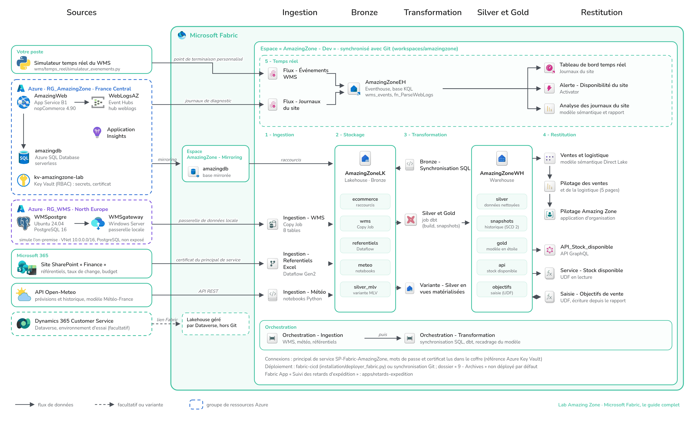

# Lab Amazing Zone – Microsoft Fabric, le guide complet

Ce dépôt contient le laboratoire qui accompagne le livre *Microsoft Fabric – Le guide complet* : le code de la
plateforme de données d'Amazing Zone (éléments Fabric, projet dbt, notebooks, pipelines, modèles sémantiques,
rapports, temps réel), les scripts des systèmes sources et la procédure complète pour reconstruire le lab dans
votre propre locataire Microsoft Entra ID, votre abonnement Azure et votre capacité Fabric.

Amazing Zone est l'entreprise fictive du livre : un site e-commerce sous nopCommerce, un WMS maison sur
PostgreSQL, Dynamics 365 Customer Service, des référentiels Excel sur SharePoint et des prévisions météo
Open-Meteo. Le chapitre 2 présente son paysage applicatif ; les chapitres 4 à 10 construisent la plateforme
que ce dépôt contient.

## Architecture du lab

Les sources sont à gauche, la plateforme Fabric à droite. Dans l'espace de développement, les dossiers « 1 - Ingestion » à
« 5 - Temps réel » correspondent à ceux du dépôt. Le schéma existe aussi en version vectorielle :
[docs/architecture-lab.svg](docs/architecture-lab.svg).

## Contenu du dépôt

| Dossier | Contenu |
|---|---|
| `installation/` | Procédure d'initialisation pas à pas et script de déploiement des éléments Fabric. |
| `ecommerce/` | Données de démonstration du site nopCommerce (clients, commandes, coûts, scénario d'évolution des prix). |
| `wms/` | Base PostgreSQL du WMS : création, migrations, rôle de lecture, données de démonstration, simulateur temps réel. |
| `referentiels/` | Classeurs Excel déposés sur SharePoint (référentiel géographique, budget des ventes). |
| `modelisation/` | Description de la chaîne Bronze, Silver, Gold et de l'orchestration (chapitre 5). |
| `workspaces/amazingzone/` | Éléments Fabric de l'espace de développement, au format de l'intégration Git de Fabric, et `parameter.yml` pour fabric-cicd. |
| `docs/` | Schéma d'architecture du lab (PNG et SVG). |
| `apps/retards-expedition/` | Fabric App « Suivi des retards d'expédition » (chapitre 6). |

## Reconstruire le lab

Comptez une journée pour l'ensemble, dont une bonne part d'attente (déploiements, premières synchronisations).
Les étapes s'enchaînent dans cet ordre, chacune renvoyant au guide détaillé :

| Étape | Guide | Résultat |
|---|---|---|
| 1 | [Identités et prérequis](installation/01-identites-et-prerequis.md) | Licences, groupe `dp-equipedata`, principal de service `SP-Fabric-AmazingZone`, paramètres du locataire Fabric, outils locaux |
| 2 | [Site e-commerce nopCommerce](installation/02-site-ecommerce-nopcommerce.md) | Azure SQL Database, App Service, installation de nopCommerce, Application Insights, journaux vers Event Hubs |
| 3 | [WMS PostgreSQL et passerelle](installation/03-wms-postgresql-et-passerelle.md) | Réseau, VM PostgreSQL et schéma `wms`, VM de la passerelle de données locale |
| 4 | [SharePoint et référentiels](installation/04-sharepoint-referentiels.md) | Site Finance, classeurs, accès du principal de service par `Sites.Selected` et certificat |
| 5 | [Coffre de clés](installation/05-coffre-de-cles.md) | Key Vault en RBAC, secrets et certificat, référence Azure Key Vault dans Fabric |
| 6 | [Dynamics 365 et Dataverse](installation/06-dynamics-dataverse.md) | Environnement d'essai Customer Service et lien Fabric (facultatif) |
| 7 | [Espaces et éléments Fabric](installation/07-fabric-espaces-et-elements.md) | Capacité, espaces, identités d'espace, connexions, mirroring, déploiement des éléments |
| 8 | [Données et première exécution](installation/08-donnees-et-premiere-execution.md) | Données de démonstration, premières ingestions, transformation, vérifications |
| 9 | [Coûts et mise en veille](installation/09-couts-et-arret.md) | Ce qui est facturé en continu, ce qu'il faut arrêter après chaque séance |

Les étapes 4 à 6 peuvent être différées : sans elles, le lab fonctionne sans les référentiels Excel, la clé
d'API météo et les données du service client, et les chapitres correspondants restent lisibles à partir des
captures du livre.

## Ce qui diffère du livre

- Le livre décrit un site nopCommerce ancien et non maintenu, ce qui sert le scénario. Le lab, lui, tourne sur
  nopCommerce 4.90 et .NET 9 : il n'y a pas de raison d'installer une version obsolète pour reproduire les
  démonstrations.
- Certains choix d'infrastructure visent le coût plutôt que le réalisme : base Azure SQL en serverless avec
  mise en pause automatique, App Service en B1 sans Always On, VM éteintes en dehors des séances.
- Les noms d'éléments, de connexions et de secrets sont ceux du livre. Vous pouvez les changer, à condition de
  reporter les changements dans `parameter.yml` et dans les variables d'environnement.

## Ce que le dépôt ne contient pas

- Aucun secret : mots de passe, clés et certificats se créent pendant l'installation et vivent dans votre fichier
  `.env` (jamais versionné, voir `.env.exemple`) ou dans le coffre de clés.
- Le Lakehouse généré par le lien Fabric Dataverse et les éléments de staging des Dataflows : Fabric les crée
  lui-même.
- La définition du tableau de bord temps réel « Tableau de bord - Journaux du site » : l'intégration Git de Fabric
  l'exporte vide. Le guide 8 explique comment le recréer.

## Utilisation et support

Le code est fourni tel quel, à des fins pédagogiques. Les données sont fictives : les clients générés ont une
adresse en `@demo.amazingzone.fr`. Pour signaler une erreur, ouvrez une *issue* sur ce dépôt.
